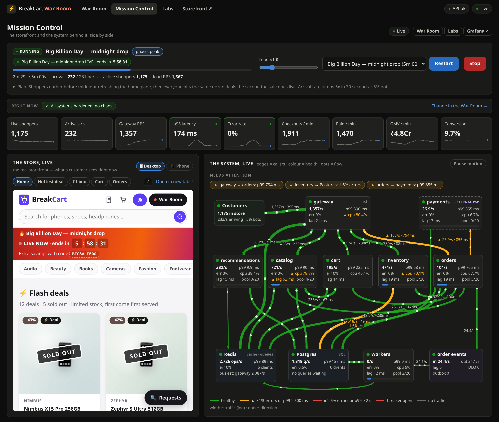
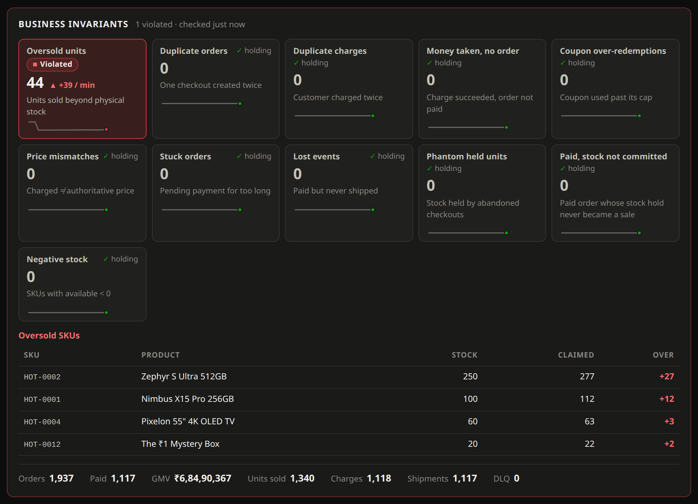
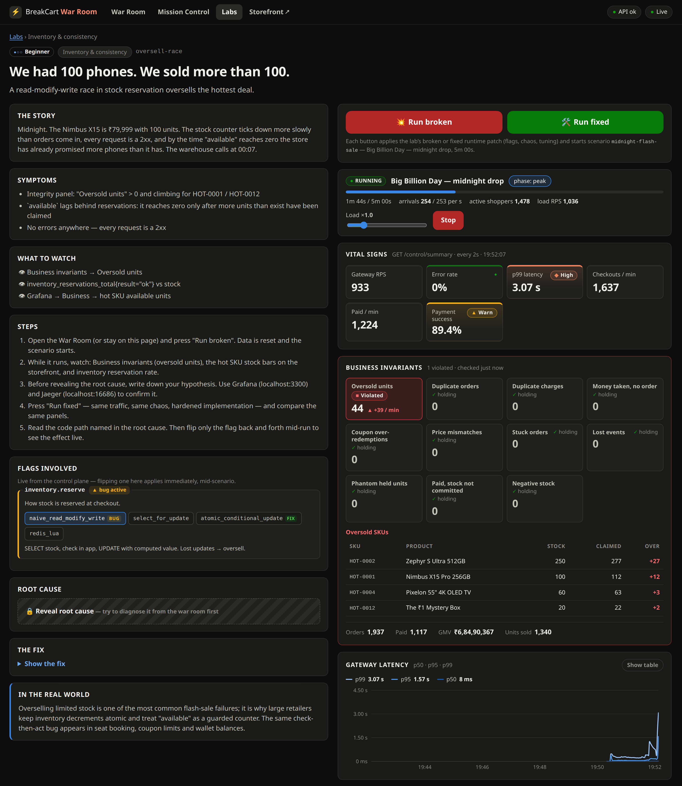
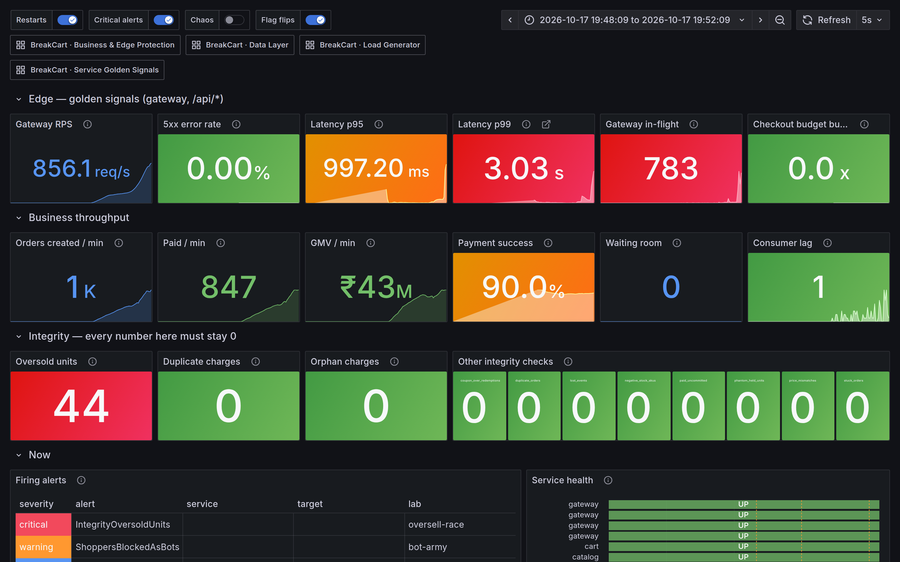
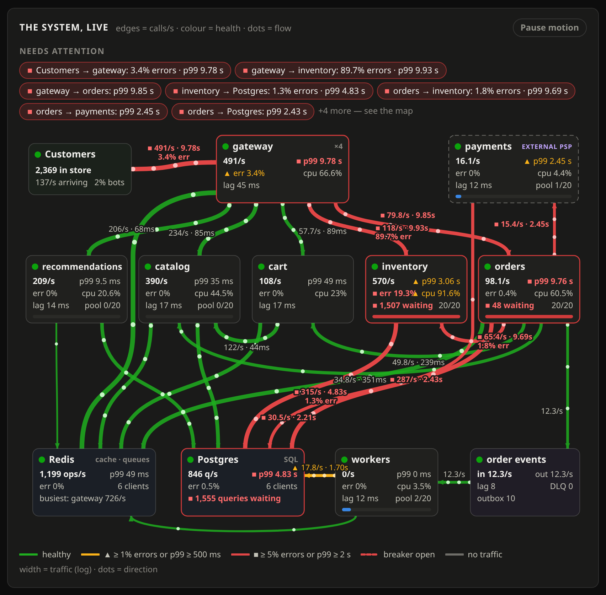

# BreakCart

**An e-commerce platform built to break on sale day — and a lab for learning how production systems fail.**

BreakCart is a small but realistic microservice storefront (gateway, catalog, inventory, cart, orders, a mock
payment provider, recommendations, async workers) running on Postgres and Redis, with Prometheus, Grafana and
Jaeger. On top sits a **control plane** that can, at runtime and without restarts:

- **switch 26 real production bugs on and off** — every one has a *naive* implementation (the code people actually
  ship) and a *hardened* one, side by side in the source;
- **inject faults** into any service — latency, errors, hangs, CPU burn, memory leaks, GC pauses, clock skew, slow
  queries, Redis outages, a payment provider that charges cards but answers too late;
- **drive sale-day traffic** — a behavioural load generator whose virtual shoppers browse, think, rage-refresh,
  double-click "Pay", abandon carts, wait in queues and get blocked, alongside scalper bots;
- **audit business invariants** — oversold units, double charges, "money taken but no order", coupon over-redemption,
  wrong prices, lost fulfilment events — the failures that never show up as a 500.

It ships with **27 labs** (each a reproducible incident with a broken and a fixed run), **12 traffic scenarios**
including 5 game days, a React storefront that lets you *feel* the latency, a live war room, 5 Grafana dashboards,
76 alerts with runbooks, and an automated verifier that proves every lab breaks and every fix works.

> Brands, products and prices are fictional. Prices are in INR (₹).

## Screenshots

**Mission Control** (`/live`): the live storefront next to the system behind it, here at the peak of a midnight
flash sale on the hardened build.



**The bug that never returns a 500.** During the oversell lab every request succeeds, and only the business-invariant
auditor notices the units sold beyond physical stock.



**A lab** (`/labs/<id>`): the incident's story, its symptoms and live flag, the root cause behind a spoiler, and a
mini war room. Run it broken, then fixed.



**Grafana's Sale Day War Room** during the same lab.



**A retry storm** on Mission Control's system map: every hop retries, and the load multiplies.



More (the storefront mid-sale, sampled shopper journeys, the War Room) are in [`docs/images/`](docs/images/).

---

## Quick start

Requirements: Docker with Compose v2, ~6 GB free RAM, 4+ CPU cores (8+ recommended). Node 22 only if you want to
develop locally. On a smaller machine, run fewer gateway replicas (`docker compose up -d --scale gateway=1`) and
use a traffic multiplier below 1 (`X=0.5`, or the slider in the war room).

```bash
make up          # builds and starts 21 containers; first run seeds 100k products (~20s)
```

| What | Where |
|---|---|
| **Mission Control** — the store and the system side by side | <http://localhost:8080/live> |
| Storefront · War Room · Labs | <http://localhost:8080> · `/warroom` · `/labs` |
| Grafana (no login) | <http://localhost:3300> |
| Jaeger | <http://localhost:16686> |
| Prometheus (+ alerts) | <http://localhost:9091> |
| Public API (via the web edge) / control plane | <http://localhost:8080/api> · <http://localhost:3010/control> |

Then:

```bash
make scenario S=normal-day        # learn what healthy looks like
make watch                        # terminal war room
make probe-ratelimit              # one client vs the rate limiter, per 100ms (try both limiter modes)
make lab LAB=oversell-race        # midnight sale, naive stock reservation — watch "oversold units" climb
make lab LAB=oversell-race VARIANT=fixed
```

Or click through it: open <http://localhost:8080/labs>, pick a lab, press **Run broken** — and keep
<http://localhost:8080/live> open next to it to watch customers and services at the same time.

---

## Architecture

```mermaid
flowchart LR
  subgraph Clients
    U[Browser<br/>storefront / war room]
    LG[loadgen<br/>shoppers + bots]
  end
  U --> W[web<br/>nginx]
  W -- /api --> GW
  W -- /control --> CP
  LG --> GW

  subgraph Edge
    GW[gateway / BFF<br/>auth · rate limit · load shedding<br/>waiting room · bot protection]
  end
  GW --> CAT[catalog<br/>products · deals · search · prices]
  GW --> INV[inventory<br/>stock · reservations]
  GW --> CART[cart]
  GW --> ORD[orders<br/>checkout · pay · coupons<br/>reconciler · outbox]
  GW -. non-critical .-> REC[recommendations]
  CART --> CAT
  ORD --> CART
  ORD --> CAT
  ORD --> INV
  ORD --> PSP[payments<br/>mock PSP]
  ORD -- OrderPaid --> STR[(Redis stream)]
  STR --> WK[workers<br/>fulfilment · outbox relay]

  CAT & INV & ORD & PSP & REC & WK --- PG[(Postgres<br/>schema per service)]
  GW & CAT & CART & ORD & INV --- RD[(Redis<br/>cache · carts · limits · queue)]

  CP[control-plane<br/>flags · chaos · scenarios<br/>labs · integrity audit] -. pub/sub .-> GW & CAT & INV & CART & ORD & PSP & REC & WK
  CP --> LG
  PROM[Prometheus] -. scrape 2s .-> GW & CAT & INV & CART & ORD & PSP & REC & WK & CP & LG
  GRAF[Grafana] --> PROM
```



- **The edge scales out.** The gateway runs as 4 replicas (a Node process is one core); Docker DNS spreads clients
  across them and Prometheus discovers replicas by DNS. Scale it yourself: `docker compose up -d --scale gateway=6`.
  Shared edge state (rate limits, waiting-room admission) lives in Redis precisely so replicas agree.
- **One image, many entrypoints.** All Node services live in `server/` (TypeScript, Fastify, undici, ioredis, pg) and
  are started with different commands. Shared platform code (`server/src/shared/`) gives every service the same
  HTTP server, metrics, retries/breakers, DB pool, chaos hooks and runtime-flag subscription.
- **Runtime knobs, not redeploys.** Flags, chaos and tuning live in Redis (`bc:runtime`); the control plane is the
  only writer and publishes a change notification; services apply it within milliseconds (and poll every 3s in case a
  notification is lost).
- **Real failure mechanics.** Races are real races against Postgres, deadlocks are real Postgres deadlocks, pool
  exhaustion is a real `pg` pool running out, memory leaks end in a real OOM kill (containers have 512 MB limits),
  synchronous logging really blocks the event loop. Where something is simulated (replica lag, the PSP itself), the
  docs say so.

Details: [docs/architecture.md](docs/architecture.md) · API & metric contract: [docs/contract.md](docs/contract.md)

---

## The labs

| Category | Labs |
|---|---|
| Inventory & consistency | [oversell-race](docs/labs/oversell-race.md) · [deadlocks](docs/labs/deadlocks.md) · [phantom-sellout](docs/labs/phantom-sellout.md) · [coupon-overrun](docs/labs/coupon-overrun.md) |
| Caching | [cache-stampede](docs/labs/cache-stampede.md) · [stale-price](docs/labs/stale-price.md) |
| Database | [pool-exhaustion](docs/labs/pool-exhaustion.md) · [n-plus-one](docs/labs/n-plus-one.md) · [slow-search](docs/labs/slow-search.md) |
| Resilience | [cascading-failure](docs/labs/cascading-failure.md) · [retry-storm](docs/labs/retry-storm.md) · [connection-churn](docs/labs/connection-churn.md) |
| Edge & traffic | [overload-collapse](docs/labs/overload-collapse.md) · [thundering-herd](docs/labs/thundering-herd.md) · [bot-army](docs/labs/bot-army.md) · [rate-limit-bursts](docs/labs/rate-limit-bursts.md) · [redis-blip](docs/labs/redis-blip.md) · [shedding-death-spiral](docs/labs/shedding-death-spiral.md) |
| Payments & money | [double-charge](docs/labs/double-charge.md) · [payment-limbo](docs/labs/payment-limbo.md) |
| Async & events | [lost-events](docs/labs/lost-events.md) · [poison-pill](docs/labs/poison-pill.md) · [replica-lag](docs/labs/replica-lag.md) |
| Runtime | [logging-meltdown](docs/labs/logging-meltdown.md) · [memory-leak](docs/labs/memory-leak.md) · [gc-pauses](docs/labs/gc-pauses.md) · [clock-skew](docs/labs/clock-skew.md) |

Each lab page has the story, symptoms, where to look, the alerts that fire, the root cause and fix (behind spoilers),
the flags involved and exercises. Start at [docs/labs/README.md](docs/labs/README.md) for a suggested path.

### How a lab works

`POST /control/labs/:id/start {variant}` (or `make lab`, or the Labs page):

1. stops any running scenario, **drains** in-flight virtual users and waits for queued database work to finish
   (so a previous run can't pollute this one — abandoned requests keep running server-side, a lesson in itself);
2. **resets** orders, payments, reservations, stock, coupons, caches and queues;
3. applies the **hardened baseline**, then the lab's *broken* or *fixed* patch (flags + chaos + tuning);
4. starts the lab's **scenario** (traffic shape + timeline of chaos events).

Same traffic, same chaos, one difference — so the contrast is the lesson.

### Proving the labs work

```bash
make verify-labs                       # every lab, broken then fixed (~2 h)
make verify-labs LABS="oversell-race double-charge"
```

The verifier (`server/src/scripts/verify-labs.ts`) asserts that each lab's failure signal appears in the broken run
and disappears (or drops by a stated factor) in the fixed run, that the fixed run still lets customers buy, and
writes `lab-verification.json` plus a Markdown report — a full run updates the committed
[`docs/lab-verification.md`](docs/lab-verification.md), a `LABS=` subset writes `lab-verification.md` at the repo root. The latest full run:
**27/27 labs verified** on a 16-core machine at ×1 traffic; later changes were re-verified on the labs they touch
(the addenda at the end of the report).

---

## Scenarios and game days

| Scenario | What happens |
|---|---|
| `normal-day` | Baseline traffic. Learn the dashboards. |
| `midnight-flash-sale` | Crowd gathers, sale goes live at T+60s, 5x spike in 30s. |
| `lightning-deals` | Calm, then 20-second waves with live price drops. |
| `singles-day` | 20 → 450 sessions/s in ten seconds. |
| `bot-army` | Limited drop, 60% of arrivals are scalper bots. |
| `festival-combos` | Bundle offers: 2–3 deals per cart in any order — sustained row-lock contention. |
| `steady-peak` | Ten-minute soak — leaks and slow creep. |
| `gameday-psp-brownout` | Payment provider slows down and answers after your timeout. |
| `gameday-redis-blip` | Redis unreachable for 20 seconds at peak. |
| `gameday-bad-deploy` | Catalog restarts (cold caches), then orders crashes. |
| `gameday-slow-recs` | "Non-critical" recommendations take 8 seconds. |
| `gameday-db-degradation` | 30% of queries on inventory and orders get +300 ms. |

The traffic is an **open model**: sessions arrive at the scenario's rate whether or not the system keeps up — like
real customers. Scale everything with the multiplier (`X=` in make, slider in the war room). See
[docs/game-days.md](docs/game-days.md) for running a game day with a team, and
[docs/postmortem-template.md](docs/postmortem-template.md).

---

## Observability

- **Mission Control** (`/live`): one screen for everything. On the left, the real storefront running live (desktop or
  phone frame — you can shop while a sale melts down) and a feed of sampled shopper journeys, each drawn as a
  request waterfall (home → product → cart → waiting room → pay) with its outcome. On the right, an animated system
  map — customers → gateway ×N → services → payment provider, Postgres, Redis and the order-event stream — where every
  edge carries live calls/s, p99 and error rate, open circuit breakers show as dashed red links, and every node shows
  health, CPU, event-loop lag and DB pool pressure (click one for details). Below: the conversion funnel, hot-deal
  stock draining, business invariants, what bugs and chaos are active right now, and the incident timeline.
- **War Room** (`/warroom`): golden signals, per-route latency, customer-perceived latency per funnel step, service
  grid (pool, event loop, memory, CPU), breakers, business invariants, incident timeline, and every control.
- **Grafana**: *Sale Day War Room*, *Services*, *Data* (Postgres, Redis, cache, streams), *Business*, *Load generator*.
- **Prometheus alerts**: SLO multi-window burn-rate alerts for checkout availability (99.5%) and latency, plus cause
  alerts that link to the lab runbooks.
- **Jaeger**: OpenTelemetry traces across gateway → services → Postgres/Redis (5% head sampling).
- **Terminal**: `make watch`.

Guide: [docs/observability.md](docs/observability.md).

---

## Developing

```bash
make install         # npm ci for server/ and web/
make infra           # postgres, redis, prometheus, grafana, jaeger in Docker
make dev             # all Node services with tsx, colour-prefixed logs
make web-dev         # React app on http://localhost:5180 (proxies /api → :3000, /control → :3010)
# UI work against the full Docker stack instead (the gateway has no host port there):
BREAKCART_GATEWAY_URL=http://localhost:8080 make web-dev
make test            # typecheck + unit tests (incl. curriculum consistency checks)
make docs            # regenerate docs/labs from server/src/shared/labs.ts
```

> `make infra` starts a dev variant of Prometheus (`infra/prometheus/prometheus.dev.yml`) that scrapes the services on
> your host via `host.docker.internal`, so the war room and Grafana work in dev mode too. Don't run `make up` and
> `make dev` at the same time — they use the same ports.

**Adding a bug:** add a flag in `server/src/shared/defs.ts` (naive + hardened modes), implement both paths, add a
lab in `server/src/shared/labs.ts` and a check in `server/src/scripts/verify-labs.ts`, run `make test docs`. The
curriculum tests fail if a lab references an unknown flag, mode, scenario or chaos key, or if its broken and fixed
variants don't differ.

**Adding a scenario:** append to `SCENARIOS` in `server/src/shared/scenarios.ts` — phases (arrival rate ramps), sale
start, bot share, behaviour overrides (think time, patience, cart sizes, coupon use…) and a timeline of chaos
patches or actions. The war room and `make scenarios` pick it up automatically.

**Adding a fault:** add a field to `ServiceChaos` (or `PaymentsChaos` / `DataChaos`) in `defs.ts` and read it where
it applies (`shared/chaos.ts` for request/process faults). The war room renders chaos controls from the defaults.

### Repository layout

```
server/                 TypeScript services (one image, many entrypoints)
  src/shared/           platform: server, http client, breaker, db, redis, metrics, runtime, chaos, defs, labs, scenarios
  src/services/*/       gateway, catalog, inventory, cart, orders, payments, recommendations, workers, control-plane
  src/loadgen/          behavioural load generator
  src/scripts/          dev runner, lab verifier, docs generator, terminal status
  test/                 unit tests
web/                    React storefront, war room, labs (Vite)
infra/                  postgres schema + seed, prometheus config + rules, grafana provisioning + dashboards
k6/                     alternative k6 load scripts
docs/                   architecture, contract, observability, game days, labs (generated)
```

## Caveats

- It is a **single-node** lab: one instance per service, one Postgres, one Redis. Numbers are about *shape*, not
  absolute capacity — a laptop's limits arrive at a few hundred sessions per second.
- Replica lag and the payment provider are simulations; everything else fails for real.
- The control plane and Grafana have no authentication. Bind to localhost (the default) and don't expose them.
